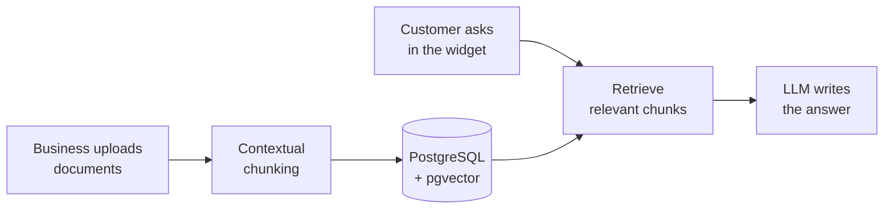

<div align="center">

# Cortex Back-End Api

**An AI shopping assistant for any website, powered by the business's own data.**

B2B RAG as a Service &nbsp;·&nbsp; Senior Project 1


[About](#about) · [Features](#features) · [Status](#status) · [Tech stack](#tech-stack) · [Getting started](#getting-started)

</div>

---

## About

Cortex puts an AI assistant on a business's existing website. The business uploads what it knows (product catalog, FAQs, policies), and the assistant answers customers from that material.

Customers don't have to search by keyword or dig through an FAQ page. They describe what they want in plain language, and the assistant finds products, compares options and can act for them, like adding an item to the cart.

> This repo is the **backend API** only. The Next.js frontend is in a separate repository, and [FRONTEND_INTEGRATION.md](FRONTEND_INTEGRATION.md) explains how the two connect.

### How it works

For a business, setup is four steps:

1. Subscribe and create an organization
2. Invite the team and upload documents
3. Customize how the assistant looks and talks
4. Paste a JavaScript snippet into the website

Behind the scenes (planned design):



## Features

| Feature | What it does |
| --- | --- |
| **Product discovery** | Customers describe what they want in their own words and get matching products back. |
| **RAG** | The assistant answers from the documents each business uploaded. |
| **Contextual chunking** | Before a chunk is embedded, an LLM adds a short note on where it sits in the full document. This is Anthropic's Contextual Retrieval technique, and it makes retrieval more accurate. |
| **Embeddable widget** | One JavaScript snippet adds the assistant to an existing site. |
| **Knowledge management** | Businesses upload and manage catalogs, FAQs, policies and other documents. |
| **Shopping in the chat** | Customers compare products and use store functions like the cart inside the conversation. |
| **Organizations and roles** | Each business gets a workspace with team invitations and role-based access control. |
| **Subscriptions** | Plans and billing are handled per organization. |
| **Customization** | The business controls the assistant's appearance, tone and behavior. |

## Status

We're still early. Accounts and organizations work today, and the AI parts come next.

| Feature | Status |
| --- | :---: |
| Registration, email verification, login, Google sign-in | ✅ Done |
| JWT access tokens with rotating refresh tokens | ✅ Done |
| Organizations, members and role-based permissions | ✅ Done |
| Knowledge upload and contextual chunking | 🚧 Planned |
| RAG chat and embeddable widget | 🚧 Planned |
| Assistant customization | 🚧 Planned |
| Commerce integrations (product lookup, add to cart) | 🚧 Planned |
| Subscriptions and billing | 🚧 Planned |

## Tech stack

| Area | Technology |
| --- | --- |
| Backend | C#, ASP.NET Core (.NET 10), Entity Framework Core |
| Frontend | Next.js, NextAuth, TypeScript, Tailwind CSS |
| Database | PostgreSQL, pgvector* |
| Caching | Redis* |
| Storage | AWS S3* |
| AI | LLMs, embedding models, RAG with contextual chunking* |
| DevOps | Docker, GitHub Actions |
| Testing | xUnit, Moq |

<sub>* Not in the code yet. These come in with the planned features.</sub>

### Project structure

The backend follows Clean Architecture, so dependencies only point inward, toward the Domain.

```
src/
├── Cortex.Domain/           Entities and business rules
├── Cortex.Application/      Use-case services, DTOs, validators, interfaces
├── Cortex.Infrastructure/   Database, migrations, JWT, password hashing, email
└── Cortex.Api/              Controllers and app startup
test/
├── Cortex.Application.Tests/
└── Cortex.Infrastructure.Tests/
```

## Getting started

**You need:** the [.NET 10 SDK](https://dotnet.microsoft.com/download), PostgreSQL running locally, and the EF Core tools:

```sh
dotnet tool install --global dotnet-ef --version 10.0.14
```

### 1. Configure settings

Settings live in user secrets, which keeps passwords and keys out of git.

<details>
<summary>Show the commands</summary>

<br/>

Run these from the repo root with your own values:

```sh
dotnet user-secrets set "ConnectionStrings:DefaultConnection" "Host=localhost;Port=5432;Database=cortex;Username=postgres;Password=your_password" --project src/Cortex.Api
dotnet user-secrets set "Jwt:Secret" "a-random-secret-at-least-32-characters-long" --project src/Cortex.Api
dotnet user-secrets set "Jwt:Issuer" "cortex-api" --project src/Cortex.Api
dotnet user-secrets set "Jwt:Audience" "cortex-frontend" --project src/Cortex.Api
dotnet user-secrets set "GoogleAuth:ClientId" "your-google-client-id" --project src/Cortex.Api
dotnet user-secrets set "Brevo:ApiKey" "your-brevo-api-key" --project src/Cortex.Api
dotnet user-secrets set "Brevo:SenderEmail" "verified-sender@example.com" --project src/Cortex.Api
dotnet user-secrets set "Brevo:SenderName" "Cortex" --project src/Cortex.Api
dotnet user-secrets set "Frontend:BaseUrl" "http://localhost:3000" --project src/Cortex.Api
```

</details>

### 2. Create the database

```sh
dotnet ef database update --project src/Cortex.Infrastructure/Cortex.Infrastructure.csproj --startup-project src/Cortex.Infrastructure/Cortex.Infrastructure.csproj
```

### 3. Run the API

```sh
dotnet run --project src/Cortex.Api
```

The API runs at `http://localhost:5203`. Open `http://localhost:5203/scalar` to try the endpoints in the browser.

### Other commands

| Task | Command |
| --- | --- |
| Run the tests | `dotnet test Cortex.slnx` |
| Run with Docker | `docker compose up --build` |

For Docker, copy `.env.example` to `.env` and fill in the values first. Docker Compose only starts the API, so you still need PostgreSQL running on your machine.

---

<div align="center">
<sub>Built as our Senior Project 1.</sub>
</div>
